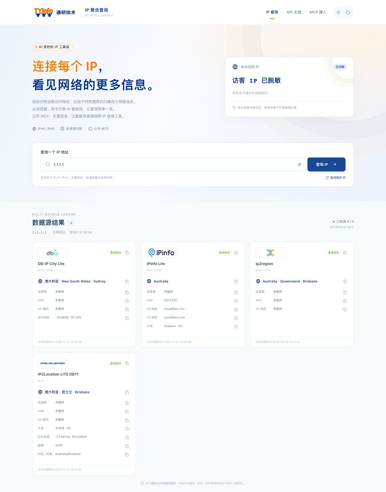

# IP 聚合查询（IPLocation）

**简体中文** | [English README](docs/README.en.md)

**一个入口，查询 IP 与多来源归属地信息。**

面向浏览器、命令行与 AI 智能体的 IP 聚合查询服务：打开即查当前访问 IP，多来源对照归属地与网络信息，通过 JSON / XML / TXT 或公开 MCP 接入自己的工作流。

[产品说明](docs/README.md) · [在线示例](https://ip.tongyaninfo.com/) · [MCP 接入](https://ip.tongyaninfo.com/#mcp) · [部署文档](deploy/README.md) · [数据源与许可](docs/spec/数据源与许可.md)

> 本项目为开源版本，源码以 [Apache License 2.0](LICENSE) 发布。示例部署域名为 `ip.tongyaninfo.com`，部署到自有环境时可替换为自己的域名与品牌；IP 数据库文件不随仓库分发，请按[数据源与许可](docs/spec/数据源与许可.md)自行获取并确认授权。



## 功能

- **浏览器即查**：自动查询本次访问 IP，支持单个 IPv4 / IPv6、查询我的 IP、手机布局及浅色 / 深色 / 自动主题。
- **多来源对照**：并列查看各库的实际字段、状态和版本；保留差异与缺失值，单源故障不覆盖其他成功结果。
- **复制即可使用**：复制字段、整卡结果、API 命令和 MCP 接入说明，减少重复整理。
- **适合脚本与应用**：curl / wget 直接返回纯 IP；结构化查询支持 JSON、XML、TXT 和指定来源或全部来源。
- **AI 友好**：公开 MCP 无需登录、API Key 或 Token，提供三个只读工具和结构化结果，让智能体调用查询与来源目录。
- **便于维护**：受保护后台提供来源启停 / 排序、上传与版本激活、访问和 MCP 调用记录、运行趋势与管理审计。

支持的来源适配器：DB-IP City Lite、纯真 QQWry、IP2Location LITE DB11、ip2region、IPinfo Lite，以及默认停用的 MaxMind GeoLite2 City。具体启用状态、地址族与覆盖范围以实际部署和已配置的数据文件为准。

## 技术栈

| 模块 | 技术 |
| --- | --- |
| 后端 | .NET 10、ASP.NET Core、EF Core、Npgsql |
| 前端 | React 19、TypeScript、Vite、Ant Design |
| 数据库 | PostgreSQL 17（后台管理、审计与访问统计；默认可关闭） |
| IP 数据 | MMDB / XDB / QQWry DAT 只读文件，仓库外配置 |

## 快速开始

需要 [.NET SDK 10.0.x](https://dotnet.microsoft.com/) 与 [Node.js 24+](https://nodejs.org/)。在仓库根目录执行：

```sh
# 1. 还原本地 .NET 工具（dotnet-ef）
dotnet tool restore

# 2. 安装并构建前端
npm --prefix frontend ci
npm --prefix frontend run build

# 3. 启动后端（默认监听 http://127.0.0.1:5080）
dotnet run --project backend/src/IpLocation.Api/IpLocation.Api.csproj --no-launch-profile
```

浏览器访问 `http://127.0.0.1:5080`。未配置数据文件的来源会显示未就绪；PostgreSQL 默认关闭，启动不会自动建库、迁移或创建管理员。

真实数据与持久化配置：

```sh
# 指定运行配置文件（绝对路径，含数据源路径等非敏感配置）
dotnet run --project backend/src/IpLocation.Api/IpLocation.Api.csproj --no-launch-profile \
  -- --Runtime:SettingsFile /absolute/path/to/runtime.json

# 创建首个管理员（密码通过私有文件提供）
dotnet run --project backend/src/IpLocation.Api/IpLocation.Api.csproj --no-launch-profile \
  -- --Admin:Initialize=true --Admin:Account=YOUR_ACCOUNT --Admin:PasswordFile=/absolute/path/to/password-file
```

后台入口为 `http://127.0.0.1:5080/console`。默认后台白名单中的 `192.0.2.0/24`、`198.51.100.0/24` 是 RFC 5737 文档示例网段，部署时请替换为实际管理网段。

Docker 部署见 [deploy/README.md](deploy/README.md) 与 [deploy/docker/README.md](deploy/docker/README.md)。

## 一条命令查询

```sh
# 当前连接 IP，纯文本
curl http://127.0.0.1:5080

# 指定 IP，全部来源，JSON
curl 'http://127.0.0.1:5080/?ip=1.1.1.1&db=all'

# 当前连接 IP，全部来源
curl 'http://127.0.0.1:5080/?db=all'

# 指定来源与格式
curl 'http://127.0.0.1:5080/?ip=1.1.1.1&db=dbip&format=xml'
```

HTTP 查询省略 `db` 默认使用 `dbip`，省略 `format` 默认 JSON；MCP 查询默认全部来源。完整参数、IPv6、TXT 及状态说明见[查询接口](docs/api/查询接口.md)。

## 让 AI 智能体调用

部署后远程服务地址为 `{你的域名}/mcp`，传输选择 **Streamable HTTP**，认证选择“无”。首页可复制完整接入说明；以下 JSON 为配置示例，字段以所用客户端要求为准：

```json
{
  "mcpServers": {
    "tongyan-ip": {
      "type": "http",
      "url": "https://ip.tongyaninfo.com/mcp"
    }
  }
}
```

| 工具 | 用途 |
| --- | --- |
| `query_ip` | 查询单个 IPv4 / IPv6，可指定来源，默认 `all` |
| `query_my_ip` | 查询 MCP 客户端本次连接的出口 IP，默认 `all` |
| `list_providers` | 查看来源启用 / 就绪状态、地址族、版本和署名 |

工具业务内容沿用 `success / code / message / data`，便于处理部分结果和来源差异。云端 MCP 客户端的“我的 IP”可能是云服务出口；本站的 AI 支持指工具接入，不内置聊天模型。详见 [MCP 接口](docs/api/MCP接口.md)。

## 隐私默认值

- 访问日志默认 **不保存完整来源 IP**（`AccessLogging:RetainFullSourceIp=false`），按 IPv4 /24、IPv6 /48 脱敏；如需完整 IP，请自行评估隐私与合规要求后显式开启。
- 请求头采集使用有界白名单快照，过滤 `Cookie`、`Authorization` 等凭据头，`Referer` 去除账户、查询串和片段。
- 示例与测试数据统一使用 RFC 5737 文档网段；仓库不包含任何真实凭据、生产主机或内网地址。

## 构建与测试

```sh
# 后端：构建 + 单元/集成测试
cd backend && dotnet build && dotnet test

# 前端：安装 + 构建 + 测试
cd frontend && npm ci && npm run build && npm test

# 文档链接与格式检查
node scripts/verify.mjs --scope docs
```

CI 配置见 [.github/workflows/ci.yml](.github/workflows/ci.yml)。

## 文档

| 入口 | 内容 |
| --- | --- |
| [中文 README](docs/README.md) / [English README](docs/README.en.md) | 产品体验、截图、HTTP 与 AI 接入 |
| [查询接口](docs/api/查询接口.md) / [MCP 接口](docs/api/MCP接口.md) | 公开协议、参数、结果与错误 |
| [后台管理接口](docs/api/后台管理接口.md) | 后台、上传、统计、审计及采集边界 |
| [后端](backend/README.md) / [前端](frontend/README.md) | 源码、运行配置与开发命令 |
| [部署](deploy/README.md) / [Compose](deploy/docker/README.md) / [离线 SQL](deploy/sql/README.md) | 部署、持久卷和显式迁移 |
| [目录规划](docs/项目目录规划.md) / [一期方案](docs/spec/一期实施方案.md) / [后台存储](docs/spec/后台存储结构草案.md) | 工程分工与设计依据 |
| [数据源与许可](docs/spec/数据源与许可.md) / [NOTICE](NOTICE) | 来源、署名和许可注意事项 |
| [验证工具](scripts/README.md) / [工程规则](AGENTS.md) / [截图说明](docs/assets/README.md) | 检查命令、开发约定与脱敏范围 |

## 参与贡献

欢迎提交 Issue 与 Pull Request。开始前请阅读 [CONTRIBUTING.md](CONTRIBUTING.md)；安全漏洞请按 [SECURITY.md](SECURITY.md) 的流程报告，不要公开提交。变更记录见 [CHANGELOG.md](CHANGELOG.md)。

## English Summary

IPLocation is an open-source IP aggregation lookup service (Apache-2.0). It provides a responsive web UI, curl/wget-friendly plain-IP responses, JSON/XML/TXT query APIs, a public read-only MCP endpoint, and a protected admin console. .NET 10 backend, React 19 + Vite frontend, optional PostgreSQL persistence; IP databases (DB-IP Lite, IP2Location LITE, ip2region, IPinfo Lite, Chunzhen, MaxMind GeoLite2) are **not** bundled and must be obtained separately under their own licenses. See [docs/README.en.md](docs/README.en.md) for details and [NOTICE](NOTICE) for data-source attribution.

## 许可

代码以 [Apache License 2.0](LICENSE) 发布。数据源、解析器及其数据文件适用各自许可，见 [NOTICE](NOTICE) 与[数据源与许可](docs/spec/数据源与许可.md)。

IP 归属地与坐标是数据库推断，不代表精确位置。截图来自本机运行页面，查询目标为 `1.1.1.1`，访客地址已脱敏。
