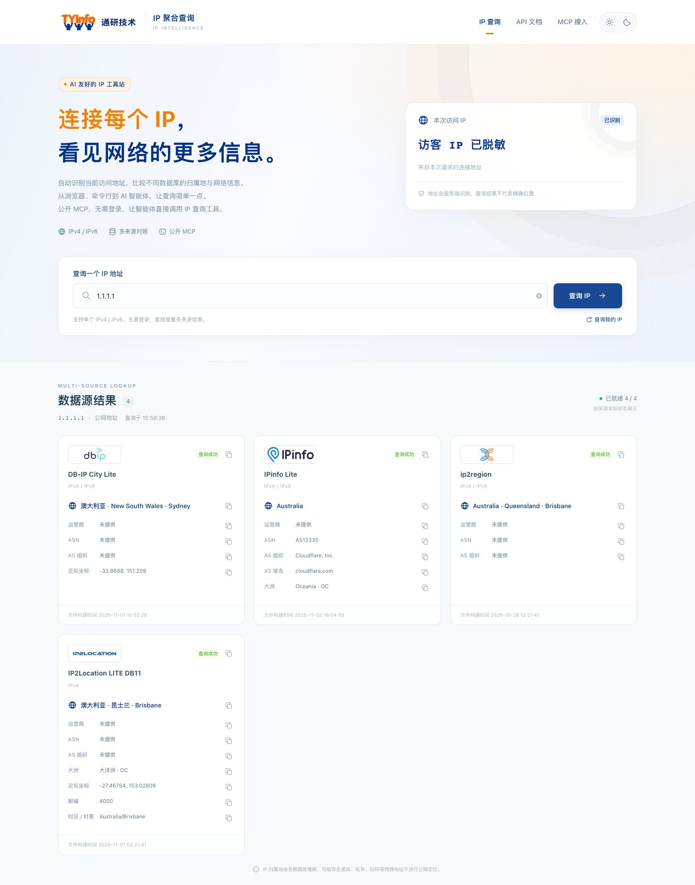
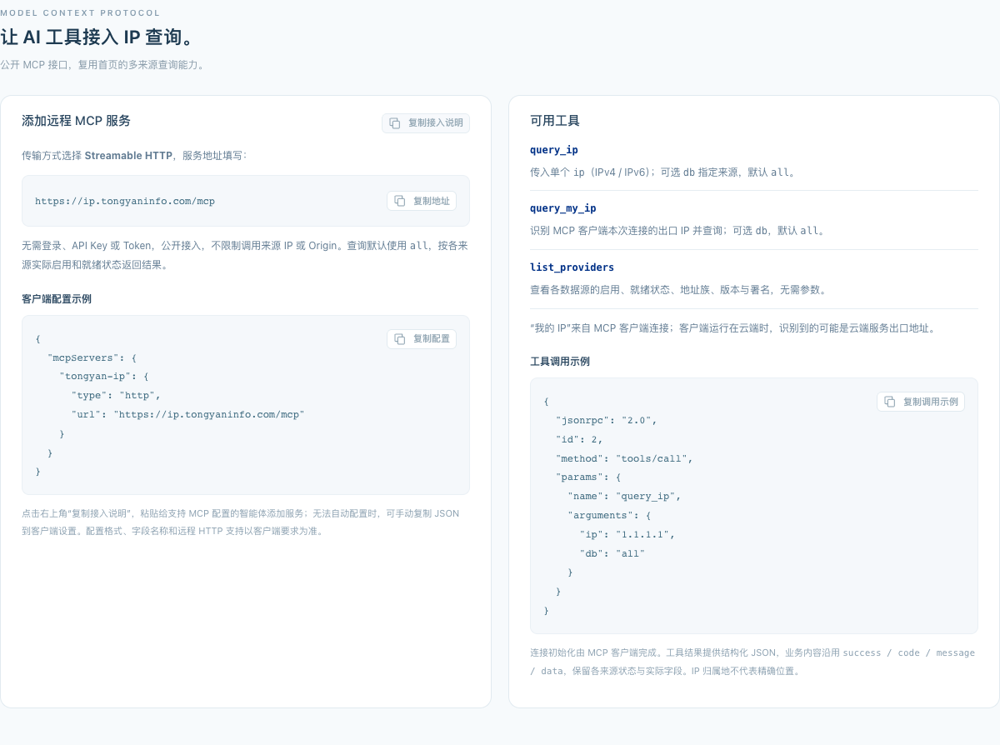
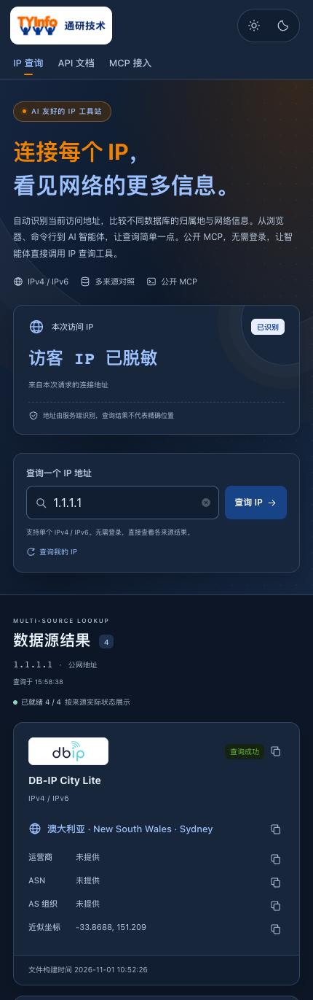

# IP Lookup

[简体中文](README.md) | **English**

**One entry point for IP lookups and location information from multiple sources.**

An IP lookup tool for browsers, the command line, and AI agents. Open the website to see the IP identified for your current request and compare location and network information from different databases. Use the JSON / XML / TXT APIs or public MCP service to bring IP lookups into your scripts, applications, and AI workflows.

[Try it now](https://ip.tongyaninfo.com/) · [MCP setup on the website](https://ip.tongyaninfo.com/#mcp) · [Development and deployment](../backend/README.md) · [Tongyan Technology](https://www.tongyaninfo.com/)

The product is in **Beta**. The website interface and default repository README are in Chinese. This page provides the English documentation; it does not indicate an English interface.



## From opening a page to integrating a workflow

| How you use it | What you can do |
| --- | --- |
| In your browser | Automatically query the IP identified for the current request; enter a single IPv4 / IPv6 address, or select “查询我的 IP” (Query my IP) to return to the current visitor address |
| Compare sources | Compare each database's results, version, status, and available fields on one page, with differences and missing information preserved |
| Copy and share | Copy individual fields, an entire result card, API commands, or complete MCP setup instructions to reduce manual formatting |
| Command line and applications | Get a plain IP using curl / wget; choose JSON, XML, or TXT and query a specific source or all sources |
| AI agents | Call IP lookup and source directory tools through public MCP without signing in or obtaining an API key |
| Desktop and mobile | Use a responsive page with light, dark, and system themes |

Use it to inspect a network's egress address, compare location differences across databases, add IP information to scripts, or let an agent retrieve results with source information when answering network questions.

## Callable tools for AI workflows

The public MCP service reuses the website's query capabilities so agents that support remote MCP can read structured results. Tool business content consistently uses `success / code / message / data`, preserving each source's status, version, and missing fields. This helps agents handle partial success, sources that are not ready, and unsupported address families.

- **Endpoint**: `https://ip.tongyaninfo.com/mcp`
- **Transport**: Streamable HTTP
- **Authentication**: No sign-in, API key, or token required; public access with cross-origin requests allowed.
- **Convenient setup**: The website provides “复制接入说明” (Copy setup instructions), which you can paste into an agent that supports MCP configuration. You can also add the service manually as required by your client.

The following example matches the website. Exact fields and remote HTTP support depend on your client:

```json
{
  "mcpServers": {
    "tongyan-ip": {
      "type": "http",
      "url": "https://ip.tongyaninfo.com/mcp"
    }
  }
}
```

| Tool | Parameters | Purpose |
| --- | --- | --- |
| `query_ip` | Required `ip`; optional `db`, defaults to `all` | Query one IPv4 / IPv6 address and compare the results actually provided by each source |
| `query_my_ip` | Optional `db`, defaults to `all` | Identify and query the egress address of the MCP client's current connection |
| `list_providers` | None | List source enabled and ready states, address families, versions, display order, and attribution |

Once connected, you can ask an agent to:

```text
Query 1.1.1.1, compare location and network information across sources, and explain their differences.
Check which IPv6 sources are currently available, then query 2606:4700:4700::1111.
Query the egress IP of your MCP connection and explain which endpoint that address represents.
```

`query_my_ip` identifies the **MCP client's egress address**. A cloud client may return a cloud service's egress IP rather than the user's browser address. AI support means callable tools and structured results; this site does not include a chat model. Whether a client can add the service automatically depends on its capabilities. Tool business results include a service source notice, while underlying database attribution is preserved. See the [MCP API contract](api/MCP接口.md) for the full protocol, errors, and logging scope.



## Start with one command

Get the current connection's IP. The response body contains only the IP and a newline:

```sh
curl https://ip.tongyaninfo.com
wget -qO- https://ip.tongyaninfo.com
```

Query location and network information:

```sh
# Query all sources for the current connection's IP
curl 'https://ip.tongyaninfo.com/?db=all'

# Query a specific IPv4 address across sources as JSON
curl 'https://ip.tongyaninfo.com/?ip=1.1.1.1&db=all'

# Query a specific IPv6 address
curl 'https://ip.tongyaninfo.com/?ip=2606:4700:4700::1111&db=all'

# Single-source XML / multiple-source TXT
curl 'https://ip.tongyaninfo.com/?ip=1.1.1.1&db=dbip&format=xml'
curl 'https://ip.tongyaninfo.com/?ip=1.1.1.1&db=all&format=txt'
```

| Parameter | Description |
| --- | --- |
| `ip` | A single IPv4 / IPv6 address; when omitted, identify the current request's connection address |
| `db` | A source ID or `all`; defaults to `dbip` for HTTP queries and `all` for MCP queries |
| `format` | `json`, `xml`, or `txt`; defaults to `json` and applies to HTTP queries |

Quote URLs containing `&`. When accessing the root path without parameters, browsers display the Chinese homepage and curl / wget receive a plain IP. The legacy `/search/{ip}` route remains compatible. HTTP business APIs share the `success / code / message / data` semantics; plain IP responses and the MCP protocol envelope follow their respective contracts. See the [query API contract](api/查询接口.md) for detailed status codes and response fields.

## Multiple sources, each keeping its own answer

| Source ID | Database / currently supported format | Address families and available information |
| --- | --- | --- |
| `dbip` | DB-IP City Lite / MMDB | IPv4, IPv6; available country, region, city, and other fields; current default database for public queries |
| `CZ88` | Chunzhen Community Edition / QQWry DAT | IPv4; original region text and network description |
| `ip2location` | IP2Location LITE DB11 / MMDB | The currently integrated file supports IPv4; available country, region, city, coordinates, postal code, time zone, and other fields |
| `ip2region` | ip2region / XDB | IPv4, IPv6; region and network information as supplied by the files |
| `ipinfo` | IPinfo Lite / MMDB | IPv4, IPv6; country, continent, ASN, AS organization, and domain; no region, city, or coordinates |

A GeoLite2 City adapter is also implemented and is currently disabled. The legacy `chunzhen` query alias remains compatible with `CZ88`; the current Chunzhen adapter does not support CZDB. Available sources and coverage depend on the deployment's enabled sources and actual data files. Check the page or `list_providers` for the current state.

The system does not fill missing fields from other sources or combine database results into a definitive fact. It accepts a single IP only and does not implicitly resolve domains, URLs, ports, or CIDR ranges. Private, loopback, and other special-purpose addresses receive classification only. Location and coordinates are database estimates and **do not represent a person's or device's precise location**.

Data files are not distributed with this repository. Use and attribution must follow each source's terms, with authorization reviewed by the deployer. See [data sources and licensing](spec/数据源与许可.md).

## An admin console for ongoing maintenance

The admin console provides operational trends, source enabling and ordering, data file upload validation and version activation, access records, MCP call records, administrator audits, and non-sensitive settings. Uploaded files require explicit activation. Individual source failures retain their own status to help troubleshooting.

`/console`, the login entry point, admin APIs, and dedicated resources are protected by a server-side IP allowlist, administrator authentication, and anti-forgery checks for write requests. Ordinary access and MCP calls are recorded asynchronously through a bounded queue. The console shows backlog, dropped events, and write failures; these records may have gaps. Access records store source IPs redacted by network by default (full IPs can be enabled by configuration) and redacted request paths. MCP records additionally contain bounded, redacted input/output snapshots. Reading these records is restricted to the protected admin console. See the [admin API contract](api/后台管理接口.md) for the complete capabilities and collection boundaries.

## Product feedback and install heartbeat

The homepage includes an in-app feedback entry for text, confirmed final screenshots, and raw WAV recordings, with no AI transcription or translation. Feedback is relayed through the product's same-origin API to the official service; receipt tokens travel only in POST bodies, and public receipts are kept in the current tab session.

The install heartbeat is enabled by default and sent every five minutes to count installations. It reports only the product identifier, installation ID, product version, operating system, CPU architecture, distribution channel, and heartbeat time; it never includes query content or visitor addresses. Administrators can review and disable automatic reporting under “产品遥测” in the console, or set `Support:TelemetryEnabled=false`. The server-side receiving implementation is not part of this repository.

## Run locally

The stack is **.NET 10 + React + TypeScript + Vite + Ant Design**. PostgreSQL provides admin persistence, while IP queries use separate read-only data files.

Prepare the .NET 10 SDK and Node.js 24 or later, then run from the repository root:

```sh
dotnet tool restore
npm --prefix frontend ci --ignore-scripts
npm --prefix frontend run build
dotnet run --project backend/src/IpLocation.Api/IpLocation.Api.csproj --no-launch-profile
```

Open `http://127.0.0.1:5080` in your browser. The default configuration can start the page and protocol endpoints, but sources without configured data paths will report that they are not ready. The repository contains no actual IP databases, administrator accounts, or database credentials.

For real lookups, prepare your own data files and runtime configuration according to the [backend guide](../backend/README.md), then explicitly provide the configuration's absolute path:

```sh
dotnet run --project backend/src/IpLocation.Api/IpLocation.Api.csproj --no-launch-profile -- --Runtime:SettingsFile /absolute/path/iplocation.runtime.json
```

PostgreSQL is disabled by default. Startup does not automatically create a database, apply migrations, or create an administrator. Reverse proxy deployments must explicitly configure trusted proxies and isolate the backend entry point. Each deployment process must use a distinct WorkerId. Full development, initialization, and deployment instructions are in the corresponding module guides.

```sh
# Documentation links and formatting
node scripts/verify.mjs --scope docs

# After changing application code, choose checks for the affected modules
node scripts/verify.mjs --scope backend
node scripts/verify.mjs --scope frontend
```

## Documentation

| Document | Contents |
| --- | --- |
| [Repository homepage](../README.md) | Default Chinese entry point and quick start |
| [Query API](api/查询接口.md) / [MCP API](api/MCP接口.md) | HTTP and agent integration contracts |
| [Admin API](api/后台管理接口.md) | Management, versions, statistics, and logging boundaries |
| [Backend](../backend/README.md) / [Frontend](../frontend/README.md) | Local configuration, source code, and development commands |
| [Deployment](../deploy/README.md) / [Compose](../deploy/docker/README.md) | Images, persistent volumes, proxies, and deployment configuration |
| [Offline SQL](../deploy/sql/README.md) / [Admin storage](spec/后台存储结构草案.md) | Persistence models and explicit migrations |
| [Directory plan](项目目录规划.md) / [Phase-one plan](spec/一期实施方案.md) | Module responsibilities and design basis |
| [Data sources and licensing](spec/数据源与许可.md) | Sources, attribution, and licensing notes |
| [Verification tools](../scripts/README.md) / [Screenshot notes](assets/README.md) | Check commands and the scope of redacted screenshots |



Screenshots are from a locally running instance, using the public DNS address `1.1.1.1` as the lookup target and masking the visitor address. They illustrate the interface and do not serve as evidence of live data or testing on a physical mobile device. This English README uses the same Chinese-interface screenshots.
