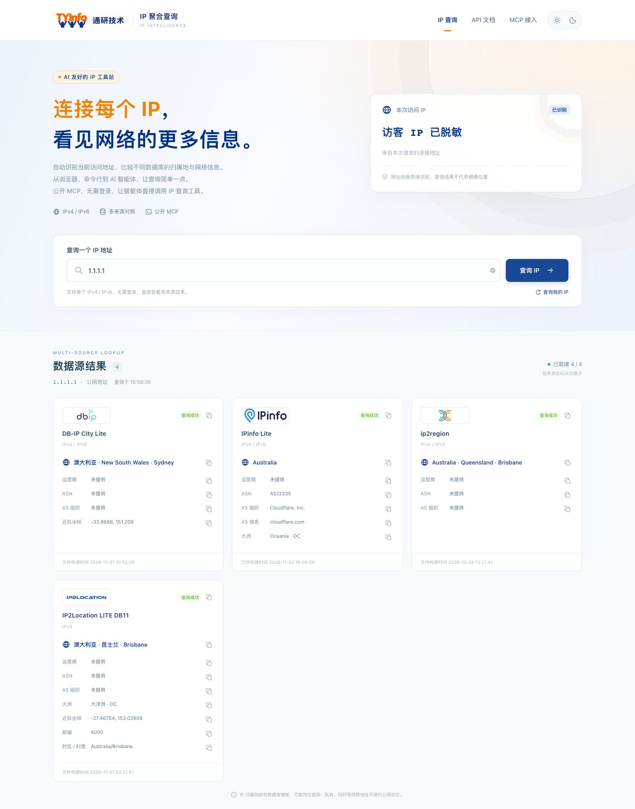
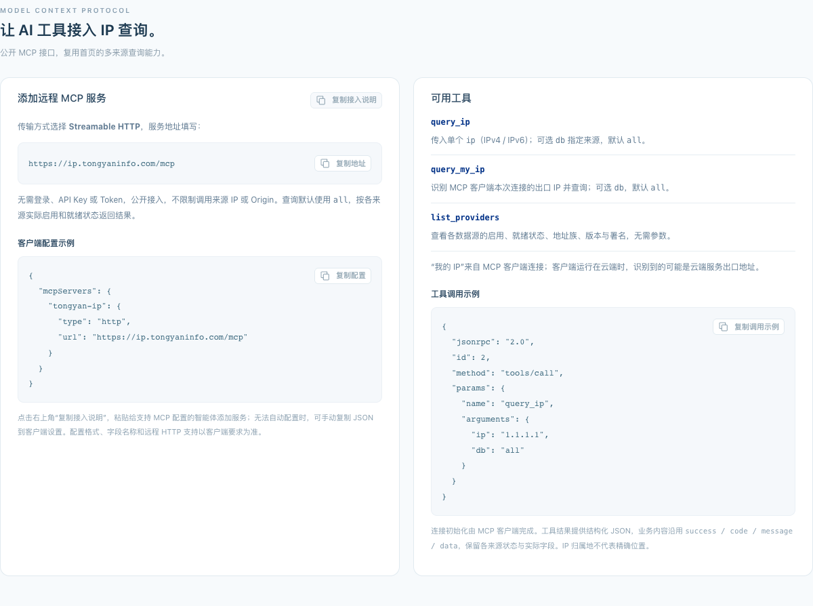
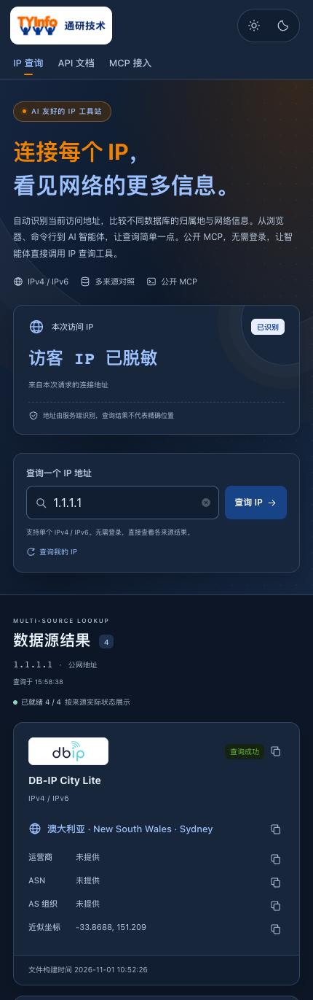

# IP 聚合查询

**简体中文** | [English](README.en.md)

**一个入口，查询 IP 与多来源归属地信息。**

面向浏览器、命令行与 AI 智能体的 IP 查询工具。打开网页即可查看本次访问 IP，对照不同数据库的归属地与网络信息；也能通过 JSON / XML / TXT 接口或公开 MCP，把查询接入自己的脚本、应用和 AI 工作流。

[立即使用](https://ip.tongyaninfo.com/) · [网页 MCP 接入说明](https://ip.tongyaninfo.com/#mcp) · [开发与部署](../backend/README.md) · [通研技术](https://www.tongyaninfo.com/)

产品处于 **Beta** 阶段。网站首页及仓库默认 README 使用中文，英文说明通过上方语言链接访问。



## 从打开网页到接入工作流

| 使用方式 | 可以做什么 |
| --- | --- |
| 浏览器即查 | 自动查询本次请求识别的 IP；输入单个 IPv4 / IPv6，或点击“查询我的 IP”返回当前访问地址 |
| 多来源对照 | 在同一页面比较各数据库的结果、版本、状态及实际字段，保留差异和缺失信息 |
| 复制与分享 | 复制单个字段、整张结果卡片、API 命令或完整 MCP 接入说明，减少手动整理 |
| 命令行与应用 | curl / wget 直接获取纯 IP；按需选择 JSON、XML、TXT 和指定来源或全部来源 |
| AI 智能体 | 无需登录或 API Key，通过公开 MCP 调用 IP 查询和来源目录 |
| 电脑与手机 | 响应式页面，提供浅色、深色和跟随系统主题 |

适用于排查网络出口、核对多库归属地差异、给脚本补充 IP 信息，或让智能体在回答网络问题时调用有来源的查询结果。

## 为 AI 工作流提供可调用工具

公开 MCP 复用网页的查询能力，让支持远程 MCP 的智能体读取结构化结果。工具业务内容统一使用 `success / code / message / data`，保留每个来源的状态、版本及缺失字段，便于智能体处理部分成功、未就绪和不支持的情况。

- **服务地址**：`https://ip.tongyaninfo.com/mcp`
- **传输方式**：Streamable HTTP
- **认证**：无需登录、API Key 或 Token；公开接入，允许跨域。
- **接入便利性**：网页提供“复制接入说明”，可粘贴给支持 MCP 配置的智能体；也可按客户端要求手动添加服务。

配置示例与网页保持一致；具体字段和远程 HTTP 支持以所用客户端为准：

```json
{
  "mcpServers": {
    "tongyan-ip": {
      "type": "http",
      "url": "https://ip.tongyaninfo.com/mcp"
    }
  }
}
```

| 工具 | 参数 | 用途 |
| --- | --- | --- |
| `query_ip` | 必填 `ip`，可选 `db`，默认 `all` | 查询一个 IPv4 / IPv6，对照各来源实际结果 |
| `query_my_ip` | 可选 `db`，默认 `all` | 识别并查询 MCP 客户端本次连接的出口地址 |
| `list_providers` | 无 | 查看来源启用及就绪状态、地址族、版本、顺序与署名 |

接入后，可以这样向智能体提出任务：

```text
查询 1.1.1.1，比较各来源的归属地与网络信息，并标明来源差异。
查看当前有哪些可用的 IPv6 数据源，再查询 2606:4700:4700::1111。
查询你的 MCP 连接出口 IP，说明这个地址代表哪一端。
```

`query_my_ip` 识别的是 **MCP 客户端出口**；云端客户端可能返回云服务出口，并非使用者浏览器的地址。AI 支持指工具接入和结构化结果，本站不内置聊天模型；客户端是否能自动添加服务取决于其自身能力。工具业务结果附服务来源提示，底层数据库署名继续保留。完整协议、错误及记录范围见 [MCP 接口](api/MCP接口.md)。



## 一条命令开始查询

获取当前连接 IP，响应正文只有 IP 和换行：

```sh
curl https://ip.tongyaninfo.com
wget -qO- https://ip.tongyaninfo.com
```

查询归属地与网络信息：

```sh
# 当前连接 IP，查询全部来源
curl 'https://ip.tongyaninfo.com/?db=all'

# 指定 IPv4，多来源 JSON
curl 'https://ip.tongyaninfo.com/?ip=1.1.1.1&db=all'

# 指定 IPv6
curl 'https://ip.tongyaninfo.com/?ip=2606:4700:4700::1111&db=all'

# 单来源 XML / 多来源 TXT
curl 'https://ip.tongyaninfo.com/?ip=1.1.1.1&db=dbip&format=xml'
curl 'https://ip.tongyaninfo.com/?ip=1.1.1.1&db=all&format=txt'
```

| 参数 | 说明 |
| --- | --- |
| `ip` | 单个 IPv4 / IPv6；省略时识别当前请求的连接地址 |
| `db` | 来源 ID 或 `all`；HTTP 查询省略时默认 `dbip`，MCP 查询默认 `all` |
| `format` | `json`、`xml` 或 `txt`，默认 `json`；用于 HTTP 查询 |

含 `&` 的 URL 请用引号包裹。无参数访问根路径时，浏览器显示中文首页，curl / wget 获取纯 IP。旧 `/search/{ip}` 路由继续兼容。HTTP 业务接口采用统一的 `success / code / message / data` 语义；纯 IP、MCP 协议外层等按各自合同处理。详细状态码和响应字段见 [查询接口](api/查询接口.md)。

## 多来源，保留各自的答案

| 来源 ID | 数据源 / 当前适配格式 | 地址族及信息范围 |
| --- | --- | --- |
| `dbip` | DB-IP City Lite / MMDB | IPv4、IPv6；国家、地区、城市等实际字段；当前公开默认库 |
| `CZ88` | 纯真 社区版 / QQWry DAT | IPv4；地区原文与网络描述 |
| `ip2location` | IP2Location LITE DB11 / MMDB | 当前接入文件为 IPv4；国家、地区、城市、坐标、邮编、时区等实际字段 |
| `ip2region` | ip2region / XDB | IPv4、IPv6；地区及网络信息，以文件内容为准 |
| `ipinfo` | IPinfo Lite / MMDB | IPv4、IPv6；国家、大洲、ASN、AS 组织及域名，不提供省市或坐标 |

另有 GeoLite2 City 适配器，当前保持停用。旧 `chunzhen` 查询别名兼容 `CZ88`；当前纯真适配器不支持 CZDB。可用来源与覆盖范围取决于部署启用状态和实际数据文件，实时情况以页面或 `list_providers` 返回为准。

系统不会用其他来源填补缺失字段，也不会把多库结果拼成确定事实。仅接受单个 IP，不隐式解析域名、URL、端口或 CIDR；私有、回环等特殊用途地址只返回分类。归属地和坐标是数据库推断，**不代表人员或设备的精确位置**。

数据文件不随仓库分发，使用和署名须遵守对应来源条款，由使用者自行核对授权。详情见 [数据源与许可](spec/数据源与许可.md)。

## 便于维护的管理后台

管理端提供运行趋势、来源启停与排序、数据文件上传校验和版本激活、访问记录、MCP 调用记录、管理审计及非敏感设置。上传后需显式激活；单源故障保留独立状态，便于排查。

`/console`、登录入口、后台 API 和专属资源由服务端 IP 白名单保护，并结合管理员身份与写请求防伪。普通访问和 MCP 调用采用有界队列异步记录，后台展示积压、丢弃和写入失败；这些记录可能存在缺口。访问记录默认按网段脱敏保存来源 IP（可配置为完整 IP），并记录脱敏后的请求路径；MCP 另有有界脱敏入出参快照，读取限受保护后台。完整能力与采集边界见 [后台管理接口](api/后台管理接口.md)。

## 产品反馈

首页提供产品内“意见反馈”入口：可提交文字说明、经确认的最终截图与原始 WAV 录音，不做 AI 转写或翻译。反馈通过本产品同源 API 转发到官方服务，回执查询码只随 POST 正文发送；公共反馈回执只保存在当前标签会话。

反馈只在用户主动提交时建立安装身份并发送请求，产品运行期间不自动注册、不上报安装心跳或统计信息。服务器端接收实现不在本仓库，由官方服务提供。

## 本地运行

技术栈为 **.NET 10 + React + TypeScript + Vite + Ant Design**；PostgreSQL 用于后台持久化，IP 查询使用独立的只读数据文件。

准备 .NET 10 SDK、Node.js 24 或更高版本，在仓库根目录执行：

```sh
dotnet tool restore
npm --prefix frontend ci --ignore-scripts
npm --prefix frontend run build
dotnet run --project backend/src/IpLocation.Api/IpLocation.Api.csproj --no-launch-profile
```

浏览器打开 `http://127.0.0.1:5080`。默认配置可启动页面与协议，但没有配置路径的来源会显示未就绪；仓库不包含真实 IP 数据库、管理员账号或数据库凭据。

需要真实查询时，按 [后端说明](../backend/README.md)准备自己的数据文件与运行配置，再显式指定配置的绝对路径：

```sh
dotnet run --project backend/src/IpLocation.Api/IpLocation.Api.csproj --no-launch-profile -- --Runtime:SettingsFile /absolute/path/iplocation.runtime.json
```

PostgreSQL 默认关闭，启动不会自动建库、迁移或创建管理员。反向代理部署应明确配置可信代理及入口隔离；每个部署进程使用独立 WorkerId。完整开发、初始化与部署步骤见对应模块文档。

```sh
# 文档链接与格式
node scripts/verify.mjs --scope docs

# 修改程序代码后，按影响面选择检查
node scripts/verify.mjs --scope backend
node scripts/verify.mjs --scope frontend
```

## 文档导航

| 文档 | 内容 |
| --- | --- |
| [仓库首页](../README.md) | 中文默认入口与快速使用 |
| [查询接口](api/查询接口.md) / [MCP 接口](api/MCP接口.md) | HTTP 与智能体接入合同 |
| [后台管理接口](api/后台管理接口.md) | 管理、版本、统计及日志边界 |
| [后端](../backend/README.md) / [前端](../frontend/README.md) | 本地配置、源码与开发命令 |
| [部署](../deploy/README.md) / [Compose](../deploy/docker/README.md) | 镜像、持久卷、代理与部署配置 |
| [离线 SQL](../deploy/sql/README.md) / [后台存储](spec/后台存储结构草案.md) | 持久化模型与显式迁移 |
| [目录规划](项目目录规划.md) / [一期方案](spec/一期实施方案.md) | 工程分工与设计依据 |
| [数据源与许可](spec/数据源与许可.md) | 来源、署名与许可注意事项 |
| [验证工具](../scripts/README.md) / [截图说明](assets/README.md) | 检查命令与脱敏截图范围 |



截图来自本机运行页面，查询目标为公共 DNS 地址 `1.1.1.1`，访客地址已遮盖；只用于展示界面，不作为实时数据或真实手机验证证明。英文 README 复用同一组中文界面截图。
